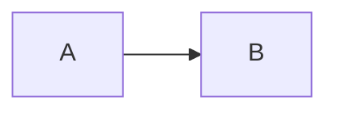

# UI交互评估

这是中文正文，包含 **粗体**、*斜体* 和 `inline code`。

## 任务与表格

- [ ] 待办任务
- [x] 已完成任务

| 项目 | 状态 |
| --- | --- |
| 编辑 | 可用 |

> 引用文本

```javascript
const answer = 42;
console.log(answer);
```

## 扩展语法

数学公式：$E=mc^2$



[跳到任务与表格](#任务与表格)


